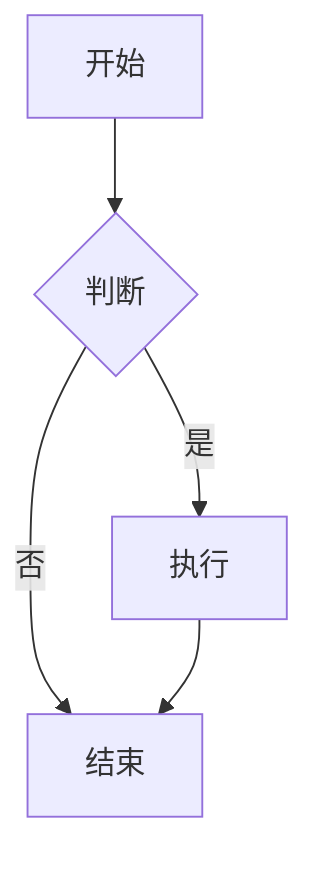
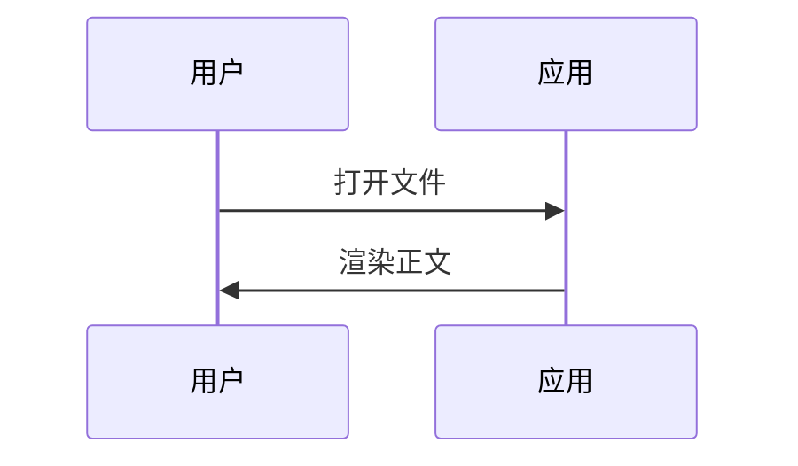
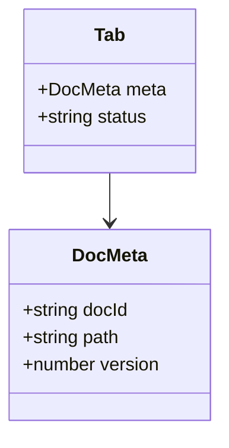
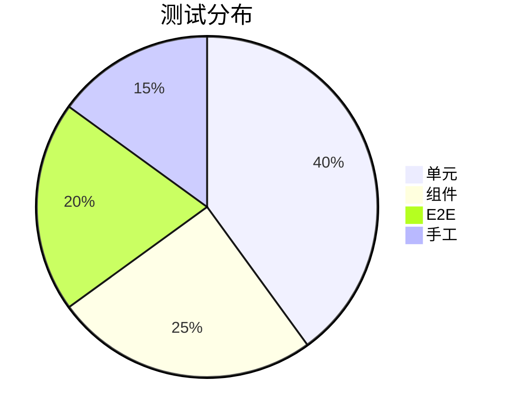

# 扩展语法测试样本

覆盖 GFM 及常用扩展：表格、任务列表、删除线、脚注、GitHub Alerts、数学公式、Mermaid、代码高亮、相对资源、原始 HTML。

## 1. GFM 表格

| 左对齐 | 居中 | 右对齐 | 默认 |
|:-------|:----:|-------:|------|
| a      | b    |      c | d    |
| 中文   | 中   |     1234 | 空格  |
| `代码` | **粗** | *斜* | [链](https://example.com) |

窄表格：

| 单列 |
|------|
| 值   |

## 2. 任务列表

- [ ] 未完成项
- [x] 已完成项
- [X] 大写 X 也算完成
- [ ] 含 **强调** 的项
  - [x] 嵌套的子任务
  - [ ] 嵌套的未完成子任务
- 普通列表项（非任务）

1. [ ] 有序任务列表
2. [x] 第二项已完成

> 注：`[ ]` 只有在列表项行首才识别；行内出现的 `[ ]` 不应变成复选框。

## 3. 删除线与行内标记

~~删除线~~、~单波浪号不删~、**粗体**、*斜体*、***粗斜***、`行内代码`、<kbd>Ctrl</kbd>+<kbd>C</kbd>。

H~2~O 与 E=mc^2^ 这类上下标不是 GFM 标准语法，默认应保持原文。

## 4. 脚注

这里引用一个脚注[^note1]，再来一个带多段的脚注[^note2]。

[^note1]: 脚注一的内容。

[^note2]: 脚注二的第一段。

    脚注二的第二段（缩进四个空格）。

## 5. GitHub Alerts

> [!NOTE]
> 这是一条 NOTE 提示，用于补充说明。

> [!TIP]
> 这是一条 TIP，提供更优做法。

> [!IMPORTANT]
> 这是一条 IMPORTANT，必须知道的信息。

> [!WARNING]
> 这是一条 WARNING，可能导致问题。

> [!CAUTION]
> 这是一条 CAUTION，可能导致数据丢失。

> [!NOTE]
> 含 **粗体**、`代码` 与 [链接](https://example.com) 的 Alert。

> 普通引用不应被识别为 Alert。
> [!NOTE] 出现在第二行也不算。

## 6. 数学公式

行内公式：$E = mc^2$，以及 $a^2 + b^2 = c^2$。

行内公式含分数：$\frac{1}{2}$ 与下标 $x_{i}$。

块级公式：

$$
\int_{-\infty}^{\infty} e^{-x^2}\,dx = \sqrt{\pi}
$$

矩阵：

$$
\begin{pmatrix}
a & b \\
c & d
\end{pmatrix}
$$

**错误公式**（应显示为红色原文，不影响其他内容）：

$$\frac{1}{$$

**不应被当作公式的美元符**：价格 $20,000 与 $30,000 不应变成数学模式。

## 7. Mermaid 图表

流程图：



时序图：



类图：



**错误图表**（应显示错误占位，不拖垮全文）：

```mermaid
graph TD
  A --> --> B
```

中文标签图表：



## 8. 代码块

```javascript
export function greet(name) {
  return `Hello, ${name}!`
}
```

```typescript
interface DocMeta {
  docId: string
  version: number
}
```

```python
def fibonacci(n: int) -> int:
    """返回第 n 个斐波那契数。"""
    a, b = 0, 1
    for _ in range(n):
        a, b = b, a + b
    return a
```

```rust
pub fn is_within(root: &Path, p: &Path) -> bool {
    p.starts_with(root)
}
```

```sql
SELECT doc_id, version FROM documents WHERE stale = 1;
```

```bash
pnpm --dir src/ui build
```

```json
{ "appTheme": "dark", "mdTheme": "paper" }
```

```css
.md-doc { --md-measure: 46rem; }
```

```diff
- 旧的一行
+ 新的一行
```

**未知语言**（应渲染为纯文本代码块并记录警告）：

```zzz-unknown-lang
这不是任何已知语言
fn main() {}
```

**无语言标识**：

```
纯文本代码块
```

**长代码块**（验证高亮不阻塞）：

```js
const arr = Array.from({ length: 200 }, (_, i) => i * 2)
```

## 9. 相对资源

同目录图片：


带标题的图片：


子目录图片：


中文文件名图片：


**缺失图片**（应显示占位并保留原路径）：


**路径越界**（默认应被拒绝）：


**损坏图片**（0 字节）：


## 10. 原始 HTML

内联 HTML：这是 <strong>粗体</strong> 与 <em>斜体</em>，还有 <code>代码</code>。

块级 HTML：

<div class="custom-block">
  <p>自定义容器中的段落。</p>
  <ul>
    <li>列表项</li>
  </ul>
</div>

<details>
<summary>折叠内容</summary>

折叠后的正文，支持 **Markdown** 语法。

</details>

表格 HTML：

<table>
  <thead><tr><th>列一</th><th>列二</th></tr></thead>
  <tbody><tr><td>1</td><td>2</td></tr></tbody>
</table>

## 11. 嵌套结构

> 引用中的列表与代码：
>
> 1. 第一项
> 2. 第二项
>
> ```js
> console.log('in quote')
> ```

- 列表中的引用：
  > 引用内容。
- 列表中的代码：
  ```python
  print('hi')
  ```
- 列表中的表格：

  | A | B |
  |---|---|
  | 1 | 2 |

## 12. 链接类型交叉（供 FR-019 使用）

- 页内：[跳到公式](#6-数学公式)
- 本地 Markdown：[跳转到多标签样本](./tabs/a.md)
- 带锚点：[跳转到 a.md 的章节](./tabs/a.md#章节一)
- 附件：[示例图片](./resources/sample.png)
- 外链：[https://example.com](https://example.com)
- 邮件：[mailto:test@example.com](mailto:test@example.com)
- 空链接：[](#)
