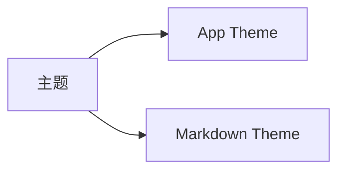

# 主题测试样本

本文件用于视觉回归：每个 Markdown 元素都要出现，且三种 Markdown Theme 下都要截图比对。

## 标题层级

# H1 一级标题

## H2 二级标题

### H3 三级标题

#### H4 四级标题

##### H5 五级标题

###### H6 六级标题

## 段落与行内标记

普通段落文本，包含 **粗体**、*斜体*、***粗斜体***、~~删除线~~、`行内代码`、[链接](https://example.com)、<kbd>Ctrl</kbd>。

带脚注的段落[^t1]。

## 列表

无序：

- 第一项
- 第二项
  - 嵌套 A
  - 嵌套 B
    - 三层
- 第三项

有序：

1. 第一步
2. 第二步
   1. 子步骤一
   2. 子步骤二
3. 第三步

任务列表：

- [x] 已完成
- [ ] 未完成
- [x] 含 **粗体** 的已完成项
  - [ ] 嵌套未完成

定义列表（非 GFM，默认按段落处理，用于观察退化行为）：

术语一
: 定义一

## 引用

> 单层引用。
>
> 第二段。

> 嵌套：
>
> > 第二层。

> [!NOTE]
> Alert 样式需与普通引用可区分。

> [!WARNING]
> 警告样式。

## 代码

行内：`const x = 1`

围栏（带语言）：

```ts
export interface Theme {
  app: 'light' | 'dark'
  md: 'light' | 'dark' | 'paper'
}
```

围栏（无语言）：

```
plain text block
```

缩进代码块：

    indented code block

## 表格

| 列一 | 列二 | 列三 |
|:-----|:----:|-----:|
| 左   | 中   | 右   |
| 1    | 2    | 3    |
| `c`  | **b**| *i*  |

## 分隔线

---

## 图片


## 公式

行内 $E=mc^2$。

$$
\begin{aligned}
a &= b + c \\
d &= e + f
\end{aligned}
$$

## Mermaid



## 混合嵌套

> 引用含列表与代码：
>
> - 项一
> - 项二
>
> ```js
> const inQuote = true
> ```

- 列表含引用：

  > 引用在列表内。

- 列表含表格：

  | A | B |
  |---|---|
  | 1 | 2 |

## 长段落（观察行宽与行高）

主题切换时，正文的行宽（`--md-measure`）、字号（`--md-font-size`）与行高（`--md-line-height`）会变化。这段文字用于观察在不同主题下，段落的可读性与视觉密度是否符合预期。中文与 English mixed 的内容都应当保持良好的换行与标点处理。

## 边界元素

空行分隔的三段：

第一段。

第二段。

第三段。

转义：\*不是斜体\*、\`不是代码\`、\\反斜杠。

实体：&amp; &lt; &gt; &quot; &copy; &nbsp;

[^t1]: 主题样本的脚注内容。
